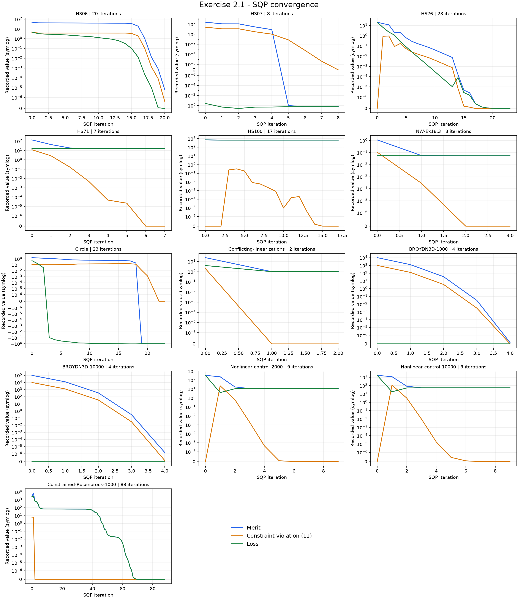
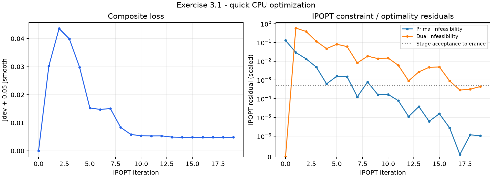
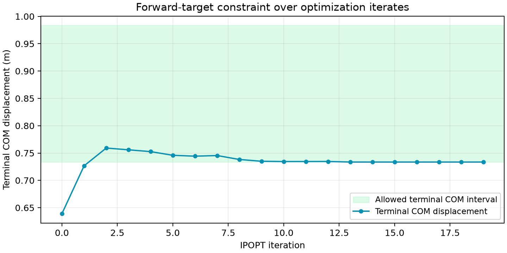
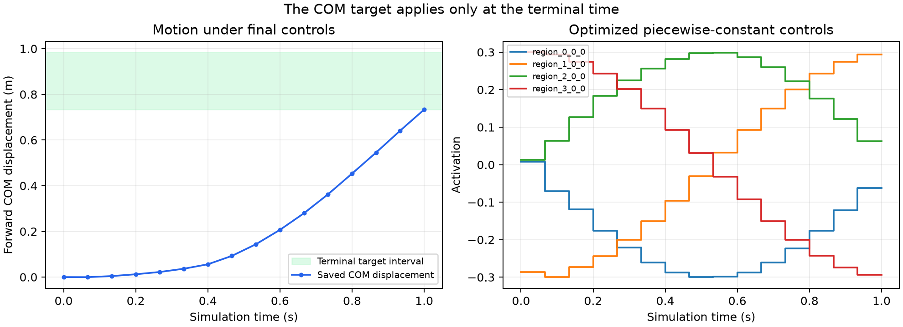
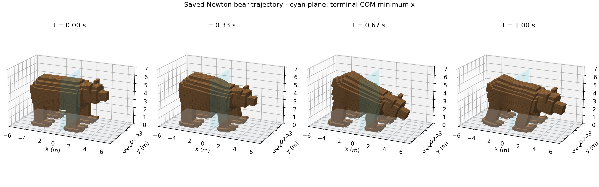
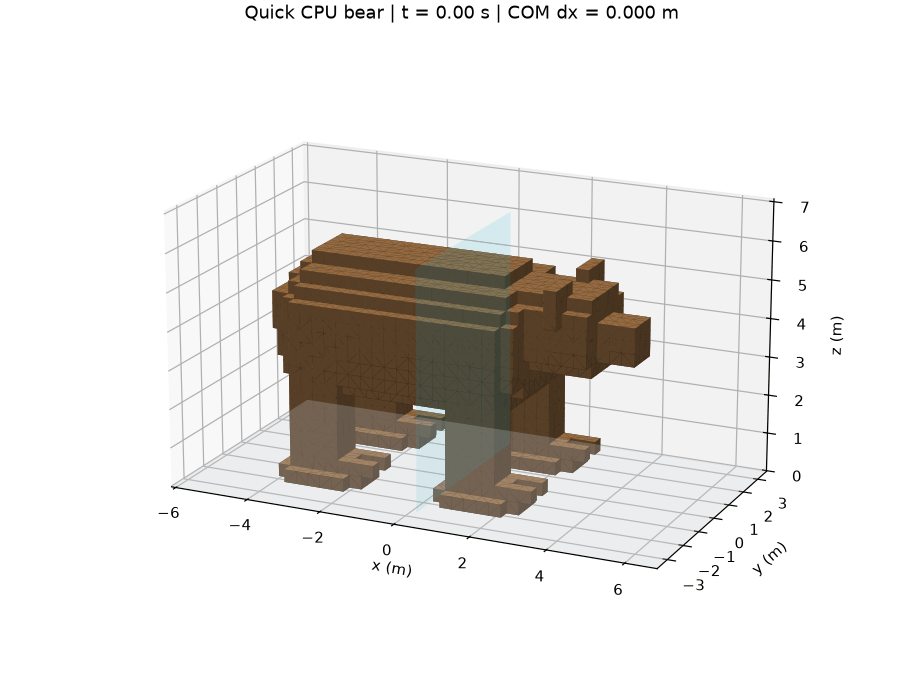

# Optimization Homework 3 - Exercises 2.1 and 3.1


## Reproduce the recorded CPU experiments

- Tested on Apple Silicon macOS with **Python 3.12.14**, JAX **0.9.0.1**, Newton **1.5.2**, Warp **1.16.0**, Pyomo **6.10.1**, and native IPOPT **3.14.19 / MUMPS**.
- Run these commands from the `hw3` directory:

```bash
python3.12 -m venv .venv
source .venv/bin/activate
python -m pip install -r requirements-reproduce.txt
python -m pip install -e "./Implementation/jax_sqp[test]" -e "./Application/bear_shooting_pyomo[bear,test]"
bash run_all.sh
```

- `run_all.sh` runs the checks, demonstrations, bear optimization, independent replay, and visual exports. It preserves nonzero exit codes and saves command output in `results/*.log`.
- `requirements-reproduce.txt` pins the packages used here. CasADi supplies the IPOPT shared library; optimization uses the supplied native C bridge and Pyomo. CasADi's optimizer is not used.
- A separately installed IPOPT runtime also works through `BEAR_IPOPT_LIBRARY`; see the supplied [installation guide](Application/bear_shooting_pyomo/docs/INSTALL.md).
- No GPU or interactive viewer is needed for these CPU results and headless visual exports.

## Exercise 2.1 - SQP

### Implementation

- [`merit.py`](Implementation/jax_sqp/jax_sqp/merit.py): sum absolute equality residuals and positive inequality residuals. Inequalities use `c <= 0`.
- [`solver.py`](Implementation/jax_sqp/jax_sqp/solver.py): evaluate `merit = loss + penalty * total_violation`.
- Equality directional terms use `sign(c) * Ap` away from zero and `abs(Ap)` at zero.
- Inequality directional terms use `Ap` for `c > 0`, zero for `c < 0`, and `max(Ap, 0)` at zero.
- KKT diagnostics measure primal feasibility, `gradient + A.T @ multipliers`, negative inequality multipliers, inequality complementarity, and the maximum of those four infinity norms.
- JAX array operations preserve `jit`, `vmap`, empty constraint groups, and float32/float64 support.
- Supporting fix: if the supplied conservative merit slope is nonnegative, check the exact one-sided derivative before rejecting the direction. This resolves the float32 HS71 line-search failure without loosening KKT tolerances.
- Supporting logging: append actual nonlinear L1 violation and merit to the history. The original eleven columns retain their positions; linearized QP violation is kept separately.

### Commands and checks

- The provided distribution uses `pytest` and `demo.py`; the PDF's older `checks.py` and `optimize.py` files are absent.
- From `Implementation/jax_sqp`, with the environment active:

```bash
python -m pytest -q
python demo.py --device cpu --precision 64 --suite all --batch --output results/cpu64_all
python demo.py --device cpu --precision 64 --suite small --merit-slope exact --output results/cpu64_exact
python demo.py --device cpu --precision 32 --suite precision --output results/cpu32_precision
python plot_results.py --input results/cpu64_all
```

- Tests: **53 passed in 41.44s**. See [test output](Implementation/jax_sqp/results/pytest.log).
- Added checks cover one-sided finite differences at constraint kinks, multiplier signs, empty constraints, precision, batching, and saved history consistency.
- Float64 full suite: **13/13 converged**, each with KKT infinity norm at most `1e-6`.
- Exact-derivative suite: **8/8 converged**.
- Float32 precision suite: **3/3 converged**, with tolerance `3e-4`.
- Batched HS71: all three starts converged in **7, 6, 5 iterations**.
- These are numerical convergence checks; they do not establish global optimality for the nonlinear problems.

### Results and plots

- [HS06](Implementation/jax_sqp/results/cpu64_all/plots/hs06.png): 20 iterations; loss `2.390688085e-14`; KKT infinity norm `9.139e-07`; **CONVERGED**.
- [HS07](Implementation/jax_sqp/results/cpu64_all/plots/hs07.png): 8 iterations; loss `-1.732050808`; KKT infinity norm `3.135e-08`; **CONVERGED**.
- [HS26](Implementation/jax_sqp/results/cpu64_all/plots/hs26.png): 23 iterations; loss `5.195687039e-10`; KKT infinity norm `6.185e-07`; **CONVERGED**.
- [HS71](Implementation/jax_sqp/results/cpu64_all/plots/hs71.png): 7 iterations; loss `17.01401729`; KKT infinity norm `2.912e-09`; **CONVERGED**.
- [HS100](Implementation/jax_sqp/results/cpu64_all/plots/hs100.png): 17 iterations; loss `680.6300574`; KKT infinity norm `2.208e-07`; **CONVERGED**.
- [NW-Ex18.3](Implementation/jax_sqp/results/cpu64_all/plots/nw18.3.png): 3 iterations; loss `0.05394984776`; KKT infinity norm `5.923e-07`; **CONVERGED**.
- [Circle](Implementation/jax_sqp/results/cpu64_all/plots/circle.png): 23 iterations; loss `-1.000000001`; KKT infinity norm `4.693e-07`; **CONVERGED**.
- [Conflicting-linearizations](Implementation/jax_sqp/results/cpu64_all/plots/conflict.png): 2 iterations; loss `1`; KKT infinity norm `0.000e+00`; **CONVERGED**.
- [BROYDN3D-1000](Implementation/jax_sqp/results/cpu64_all/plots/broyden1000.png): 4 iterations; loss `0`; KKT infinity norm `2.106e-07`; **CONVERGED**.
- [BROYDN3D-10000](Implementation/jax_sqp/results/cpu64_all/plots/broyden10000.png): 4 iterations; loss `0`; KKT infinity norm `2.047e-07`; **CONVERGED**.
- [Nonlinear-control-2000](Implementation/jax_sqp/results/cpu64_all/plots/control2000.png): 9 iterations; loss `11.22078142`; KKT infinity norm `3.861e-07`; **CONVERGED**.
- [Nonlinear-control-10000](Implementation/jax_sqp/results/cpu64_all/plots/control10000.png): 9 iterations; loss `54.16199928`; KKT infinity norm `8.251e-07`; **CONVERGED**.
- [Constrained-Rosenbrock-1000](Implementation/jax_sqp/results/cpu64_all/plots/rosenbrock1000.png): 88 iterations; loss `3.373025064e-15`; KKT infinity norm `7.559e-07`; **CONVERGED**.

- Each individual plot shows **merit, actual nonlinear L1 constraint violation, and loss together**.
- Symmetric log axes preserve negative losses and exact zeros. Changing the penalty can change merit between iterations.
- Raw results: [summary CSV](Implementation/jax_sqp/results/cpu64_all/summary.csv), [solver report](Implementation/jax_sqp/results/cpu64_all/report.json), and [command output](Implementation/jax_sqp/results/demo_cpu64_all.log).
- Per-iteration CSVs are in `Implementation/jax_sqp/results/cpu64_all/histories/`; solution vectors and multipliers are in `solutions/` beside it.



### AI acknowledgment - Exercise 2.1

- OpenAI Codex assisted with implementation, comments, tests, numerical debugging, plots, and this writeup.
- Reported numbers come from actual executions of the included code.

## Exercise 3.1 - Bear locomotion

### Implementation

- Completed the three marked functions in [`examples/bear_run.py`](Application/bear_shooting_pyomo/examples/bear_run.py).
- `gait_deviation`: mean of `((u - control_center) / search_radius)^2` over all intervals and actuators.
- `correction_smoothness`: mean squared difference between consecutive **corrections**, normalized by `search_radius`; weight **0.05**. Omitted when there is only one interval.
- `forward_target`: enforce `target_distance <= terminal_COM_x - start_COM_x <= target_distance + target_window`.
- Scale this constraint by `target_distance`; physical bounds stay in metres and the feasibility tolerance is relative to the target.
- Call `problem.solve` with the initial controls, `engine="ipopt"`, supplied stage options, and `STAGE_FEASIBILITY_TOLERANCE = 5e-4`. Return the complete `SolveResult`.
- Kept the supplied simulation, physics substeps, control bounds, continuation driver, and warm starts.
- Added accepted-iterate logging through IPOPT's [current-iterate C interface](https://github.com/coin-or/Ipopt/blob/stable/3.14/src/Interfaces/IpStdCInterface.h). This records actual terminal constraint values and controls without rerunning the simulator inside the callback.

### Commands and checks

- From `Application/bear_shooting_pyomo`, with the environment active:

```bash
export WARP_CACHE_PATH="$PWD/.warp-cache"
export MPLCONFIGDIR="$PWD/.matplotlib-cache"
python scripts/check_environment.py --test-ipopt
python -m pytest -q
python examples/bear_run.py --size quick --device cpu
python scripts/verify_bear_run.py
python scripts/render_deliverables.py
```

- Environment probe: passed with a real native IPOPT solve. See [environment output](Application/bear_shooting_pyomo/results/environment.log).
- Tests: **15 passed in 0.59s**. See [test output](Application/bear_shooting_pyomo/results/pytest.log).
- Added tests compare objective values and gradients with independent NumPy calculations and finite differences, handle one interval, and solve a small analytic fixture through the student IPOPT call.
- Ran the README's **quick CPU** profile: **1 second**, **15 control intervals**, **4 actuators**, **4,800 physics substeps**, and one continuation stage.
- The PDF refers to a small CPU problem; this distribution calls its recommended CPU problem `quick`. The separate five-second `small` profile is documented for CUDA and was not run here. No CUDA device is available on this Mac.

### Recorded result

- Solver status: **Solved_To_Acceptable_Level**, accepted and independently feasible.
- IPOPT iterations: **19**; recorded iterates include iteration zero.
- Final loss: **0.004822128551**.
- Deviation contribution: `0.004421149302`.
- Weighted smoothness contribution: `0.0004009792494`.
- Forward target interval: **[0.733500338, 0.983500338] m**.
- Final forward COM displacement: **0.733514077 m**, or **0.075001405 body lengths**.
- Final task violation: **0 m**; control-bound violation: **0**.
- Independent replay reaches the target: **True**; maximum saved/replayed observation difference: **0**.
- Solver time: **203.42 s**; total process time: **210.59 s**. Runtime varies by machine.
- This short profile mainly shows rocking and forward deformation; the README reserves longer visible locomotion for the CUDA profiles.

### Plots and animation

- [Full optimization output](Application/bear_shooting_pyomo/results/bear_run_quick.log), [solver report](Application/bear_shooting_pyomo/results/bear_run_quick.json), and [independent replay report](Application/bear_shooting_pyomo/results/bear_run_quick_verification.json).
- [Iteration CSV](Application/bear_shooting_pyomo/results/figures/ipopt_iterations.csv): loss, IPOPT residuals, accepted controls, and terminal constraint values.
- The constraint plot evaluates the **terminal COM displacement at each optimizer iterate**. The motion plot instead uses simulation time under the final controls.
- Snapshots and GIF use the exact saved Newton particle positions at control knots, a fixed camera, and no replacement physics.
- The cyan plane marks the lower bound on **terminal COM x**, not a bound on every vertex or intermediate state.
- The GIF holds each saved knot for approximately `1/15` second; GIF timing is quantized to 10 ms.
- Replay data: `results/bear_run_quick.npz`, `results/bear_run_quick_particles.npz`, and `results/bear_run_quick_task.json` within the application project.
- [Animated USD mesh](Application/bear_shooting_pyomo/results/bear_run_quick.usda) is also included for external playback.











### AI acknowledgment - Exercise 3.1

- OpenAI Codex assisted with the objective and constraint code, solver call, comments, tests, environment setup, iteration logging, visual exports, and this writeup.
- The animation and numerical results were generated from real Newton/Warp and IPOPT executions.
