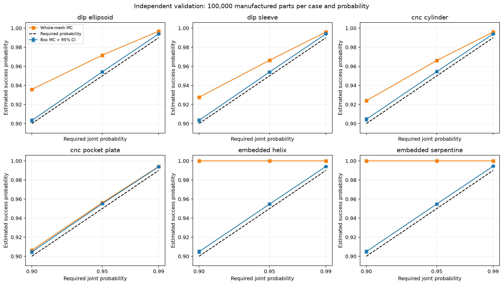
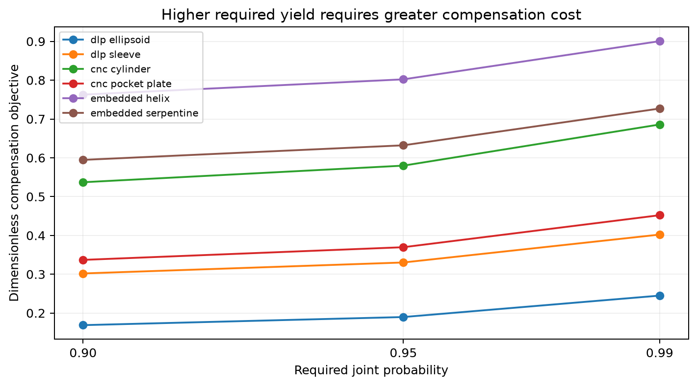
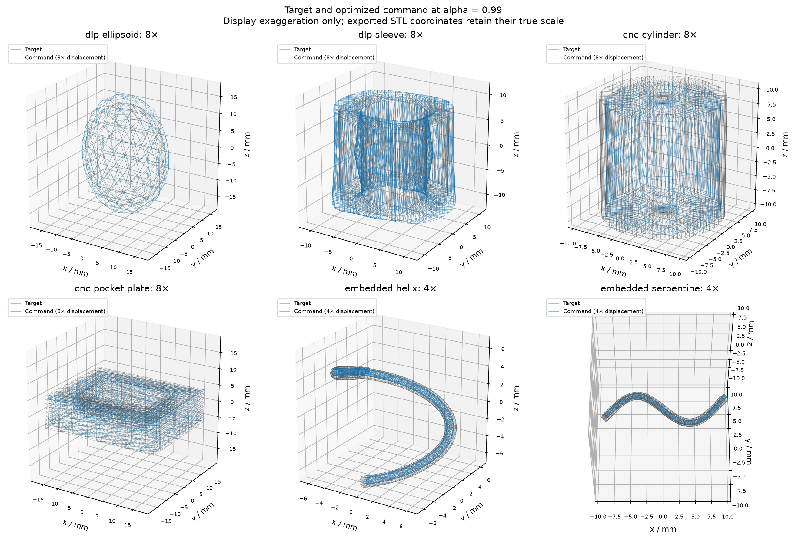

# Application writeup

## Exercise 3.1: Chance-constrained geometry compensation

- Optimize dimensionless commands `x`; convert them to millimeter commands using `u = Sx`.
- Use the supplied affine error model `a = b + GSx + Lξ`, with the full supplied covariance `Σ = LLᵀ`.
- Set the solver response to **H = GS**. Keep the supplied bias, covariance, case name, and requested probability unchanged.
- Enforce **one joint event**: every output coefficient must satisfy its interval simultaneously with probability at least `alpha`. Separate marginal 95% constraints would not imply 95% joint success.
- Return the formulation in `AffineGaussianBox`; use the supplied probability oracle and Veinott solver afterward.

## DLP and CNC formulations

- Let `d` be the number of supplied coefficients, `W` the vertex interpolation matrix, and `ω` the normalized vertex-area weights.
- Since the surface penalty is `0.5 * [0.85 * sum_i ω_i (Wx)_i² + (0.15/d) * ||x||²]`, the solver data are **Q = 0.85 Wᵀ diag(ω) W + (0.15/d) I** and **c = 0**.
- Set `S = tolerance_mm * I`, so **H = tolerance_mm * G**. The objective is dimensionless as specified; do not insert an extra squared millimeter scale into `Q`.
- Set all coefficient limits to `[-tolerance_mm, +tolerance_mm]`.
- **DLP:** use decision bounds `[-4, 4]`. The tolerances are `0.200 mm` for the ellipsoid and `0.160 mm` for the sleeve.
- **CNC:** use decision bounds `[-4, 0]` to permit only inward compensation. The tolerances are `0.120 mm` for the cylinder and `0.140 mm` for the pocket plate.
- A shared private helper assembles this common surface formulation; only the decision upper bound differs between DLP and CNC.

## Embedded extrusion formulation

- Read the control count `K` and section count `N_s` from `basis.weights.shape`; preserve channel order `(dx, dy, dz, radius)`.
- Build the half-width vector **t = ((τ_p/√3) 1_(3K), τ_r 1_K)**. Set **S = diag(t)**, **H = GS**, **lower = -t**, and **upper = t**.
- Use the supplied budgets and radius. In these cases `τ_p = 0.180 mm`, `τ_r = 0.060 mm`, and `r_0 = 0.600 mm`.
- With `X` formed by putting the four channel vectors in columns, define **M = (0.85/N_s) WᵀW + (0.08/K) I + (0.07/K) D₂ᵀD₂**.
- The requested objective is `(1/8) * sum_channels x_channelᵀ M x_channel`. Matching the solver's `(1/2) xᵀQx` gives **Q = block_diag(M, M, M, M) / 4**, **c = 0**.
- Form `D₂` from second differences of the identity. This also handles fewer than three controls, when the smoothness term has no rows.
- Set centerline decision bounds to `[-6, 6]` and radius bounds to `±0.45 r_0 / τ_r`, which are `±4.5` for the supplied data.
- For each section and XYZ coordinate, use `A_pos x = (τ_p/√3) W x_channel`. Append a zero block for radius controls.
- Reserve the maximum allowed radius `1.45 r_0` at each bath wall. Stack **A_ub = [A_pos; -A_pos]** and **b_ub = [B_max - 1.45 r_0 - p*; p* - B_min - 1.45 r_0]**, with coordinates stacked in channel order.
- These inequalities keep the commanded centerline and the reserved circular filament envelope inside the bath at every supplied path section.

## Why the coefficient event controls geometry

- DLP/CNC basis weights are nonnegative and sum to one. If every output coefficient has magnitude at most `τ`, every interpolated normal displacement also has magnitude at most `τ`.
- For embedded extrusion, each interpolated centerline component is bounded by `τ_p/√3`, so the centerline displacement norm is at most `τ_p`. The radius displacement is at most `τ_r`.
- The triangle inequality then bounds each embedded ring-vertex displacement by `τ_p + τ_r = 0.240 mm`. The target ring directions remain fixed.
- The coefficient-box event is sufficient for the mesh tolerance. It can be conservative, so directly simulated whole-mesh yield can exceed coefficient-box yield.

## Numerical procedure and validation

- Run all six physical cases at `alpha ∈ {0.90, 0.95, 0.99}` in separate directories. The `--case all` command also runs the three supplied abstract checks.
- Use the supplied settings: `2,048` optimizer QMC points, a `0.004` probability buffer, and `100,000` independent validation draws per physical case.
- The working probability targets are `0.904`, `0.954`, and `0.994`. The buffer provides numerical headroom; it does not certify integration accuracy.
- Check each solution with four independent `8,192`-point QMC scrambles and the supplied SciPy Gaussian-box integral.
- Report individual two-sided 95% Clopper-Pearson intervals for the Monte Carlo yields. These intervals cover sampling error, not uncertainty in the process model.
- All objective and bath-constraint formulas pass **six tests**, including embedded problems with `2`, `3`, `5`, and `6` controls.
- The process models are the assignment's synthetic surrogates. The diagnostic LP gap from approximate probability cuts is not a certified global optimality bound.

## Reproduce the application

- From the submission root, first run `bash setup.sh`.
- Run `.venv-application/bin/python -m geocomp --case all --alpha 0.90 --out Application/results_a090 --verbose`.
- Repeat with `--alpha 0.95 --out Application/results_a095` and `--alpha 0.99 --out Application/results_a099`.
- Run `.venv-application/bin/python Application/summarize_results.py` to regenerate the tables, static figures, and the results below.
- Test the formulas with `.venv-application/bin/python -m pytest Application/tests -q`.

<!-- GENERATED RESULTS -->

## Results from all 18 physical runs

- All **18 physical cases converged**. The unrounded optimized decisions and millimeter commands are in [optimized_variables.csv](results/optimized_variables.csv).
- The table gives independent Monte Carlo coefficient-box yield and its individual 95% interval; the whole-mesh yield is listed separately.
- Full precision probability checks, model data, and solver traces are retained in each case's `metrics.json`, `arrays.npz`, and `optimization.json`.

| Case | alpha | Cost | Iterations | Box yield [95% CI] | Mesh yield |
| --- | ---: | ---: | ---: | --- | ---: |
| dlp_ellipsoid | 0.90 | 0.168830 | 69 | 0.90326 [0.90141, 0.90509] | 0.93580 |
| dlp_sleeve | 0.90 | 0.301998 | 81 | 0.90336 [0.90151, 0.90518] | 0.92759 |
| cnc_cylinder | 0.90 | 0.537028 | 85 | 0.90450 [0.90266, 0.90631] | 0.92396 |
| cnc_pocket_plate | 0.90 | 0.336961 | 85 | 0.90459 [0.90275, 0.90640] | 0.90639 |
| embedded_helix | 0.90 | 0.762813 | 310 | 0.90483 [0.90299, 0.90664] | 1.00000 |
| embedded_serpentine | 0.90 | 0.594633 | 330 | 0.90489 [0.90305, 0.90670] | 1.00000 |
| dlp_ellipsoid | 0.95 | 0.189690 | 68 | 0.95425 [0.95294, 0.95554] | 0.97174 |
| dlp_sleeve | 0.95 | 0.330274 | 78 | 0.95403 [0.95271, 0.95532] | 0.96633 |
| cnc_cylinder | 0.95 | 0.579801 | 82 | 0.95449 [0.95318, 0.95577] | 0.96613 |
| cnc_pocket_plate | 0.95 | 0.369622 | 81 | 0.95513 [0.95383, 0.95640] | 0.95615 |
| embedded_helix | 0.95 | 0.802153 | 301 | 0.95471 [0.95340, 0.95599] | 1.00000 |
| embedded_serpentine | 0.95 | 0.632158 | 319 | 0.95484 [0.95353, 0.95612] | 1.00000 |
| dlp_ellipsoid | 0.99 | 0.244898 | 73 | 0.99399 [0.99349, 0.99446] | 0.99684 |
| dlp_sleeve | 0.99 | 0.402146 | 80 | 0.99407 [0.99357, 0.99454] | 0.99600 |
| cnc_cylinder | 0.99 | 0.685798 | 89 | 0.99404 [0.99354, 0.99451] | 0.99602 |
| cnc_pocket_plate | 0.99 | 0.452076 | 80 | 0.99383 [0.99333, 0.99431] | 0.99409 |
| embedded_helix | 0.99 | 0.900518 | 300 | 0.99419 [0.99370, 0.99465] | 1.00000 |
| embedded_serpentine | 0.99 | 0.726903 | 340 | 0.99448 [0.99400, 0.99493] | 1.00000 |

## Interpretation

- Every optimized coefficient-box Monte Carlo lower confidence limit exceeds its requested target. These are individual intervals, not a simultaneous coverage statement over all 18 experiments.
- The smallest lower-limit headroom is **0.001411** in probability units.
- The largest difference between the optimizer probability and the independent QMC mean is **3.317e-05**; the corresponding largest SciPy difference is **3.995e-05**.
- Compensation cost increases with the requested yield for every geometry: tighter chance constraints shrink the feasible set.
- The uncompensated coefficient-box probabilities are extremely small. Correcting systematic bias produces a large improvement in modeled yield.
- The embedded whole-mesh yield is especially conservative relative to the coefficient box: the sum of separate centerline and radius budgets bounds displacement, but both worst cases need not occur together.

## Exaggerated geometry visualizations

- DLP/CNC static figures use **8× displacement**; embedded figures use **4× displacement**. Gray is the target and blue is the compensated command.
- The supplied offline viewers include target, command, uncompensated output, compensated output, paired random realizations, bath context, and solver convergence. Select the display factor and realization using their controls.
- Exported STLs retain the actual millimeter coordinates. Exaggeration only changes the display.

- **alpha = 0.90:** [Open the supplied interactive viewer](results_a090/viewer.html).

- **alpha = 0.95:** [Open the supplied interactive viewer](results_a095/viewer.html).

- **alpha = 0.99:** [Open the supplied interactive viewer](results_a099/viewer.html).

## Optimized dimensionless variables

- Entries below are rounded to six decimals for reading; use the linked metrics or CSV for all available digits.
- Surface vectors follow the supplied mode order. Embedded vectors are shown in four channel blocks, each ordered along the path.

### alpha = 0.90

- **dlp_ellipsoid** ([full precision](results_a090/dlp_ellipsoid/metrics.json)):
  - `x = (1.268171, 1.427831, 0.448316, 0.431907, -0.157148, -0.182068, 0.456970, 0.449055)`
- **dlp_sleeve** ([full precision](results_a090/dlp_sleeve/metrics.json)):
  - `x = (0.754516, 1.524176, 0.772195, 1.462838, 0.100713, 0.093954, -0.868357, -0.873380)`
- **cnc_cylinder** ([full precision](results_a090/cnc_cylinder/metrics.json)):
  - `x = (-1.231708, -0.873973, -1.216898, -0.838807, -1.208710, -1.205373, -0.529888, -0.972368)`
- **cnc_pocket_plate** ([full precision](results_a090/cnc_pocket_plate/metrics.json)):
  - `x = (-0.943201, -0.624061, -0.326392, -0.304179, -1.076170, -1.306351, -1.273435, -0.953671)`
- **embedded_helix** ([full precision](results_a090/embedded_helix/metrics.json)):
  - `dx = (0.999990, 1.107560, -4.316296, 1.093960, 1.379306)`
  - `dy = (-0.108310, 2.091281, -0.017354, -2.492548, 0.214857)`
  - `dz = (0.463420, 0.451143, 0.499268, 0.545061, 0.598919)`
  - `radius = (-0.773001, -0.771026, -0.833999, -0.901544, -0.965721)`
- **embedded_serpentine** ([full precision](results_a090/embedded_serpentine/metrics.json)):
  - `dx = (0.257257, 1.391486, -0.112517, 1.613321, 0.457377)`
  - `dy = (0.814478, 1.017484, -3.791354, 1.023499, 1.086926)`
  - `dz = (-0.008026, 0.561767, 0.521763, 0.663409, 0.010107)`
  - `radius = (-0.767863, -0.767730, -0.831758, -0.900846, -0.962647)`

### alpha = 0.95

- **dlp_ellipsoid** ([full precision](results_a095/dlp_ellipsoid/metrics.json)):
  - `x = (1.322988, 1.479731, 0.497772, 0.482141, -0.144748, -0.156181, 0.498998, 0.497649)`
- **dlp_sleeve** ([full precision](results_a095/dlp_sleeve/metrics.json)):
  - `x = (0.804237, 1.577802, 0.824900, 1.513931, 0.131964, 0.131730, -0.918141, -0.917996)`
- **cnc_cylinder** ([full precision](results_a095/cnc_cylinder/metrics.json)):
  - `x = (-1.272154, -0.914126, -1.257915, -0.878031, -1.253160, -1.251225, -0.566031, -1.011506)`
- **cnc_pocket_plate** ([full precision](results_a095/cnc_pocket_plate/metrics.json)):
  - `x = (-0.982945, -0.664226, -0.358649, -0.340633, -1.124797, -1.353081, -1.320062, -0.992890)`
- **embedded_helix** ([full precision](results_a095/embedded_helix/metrics.json)):
  - `dx = (1.030658, 1.155189, -4.376541, 1.143998, 1.421921)`
  - `dy = (-0.109258, 2.140464, -0.017059, -2.548545, 0.220858)`
  - `dz = (0.497444, 0.489800, 0.540297, 0.587307, 0.640493)`
  - `radius = (-0.807131, -0.808081, -0.877923, -0.944923, -1.011355)`
- **embedded_serpentine** ([full precision](results_a095/embedded_serpentine/metrics.json)):
  - `dx = (0.291039, 1.440971, -0.124358, 1.668987, 0.503817)`
  - `dy = (0.835396, 1.065144, -3.851629, 1.074487, 1.133757)`
  - `dz = (0.013629, 0.603672, 0.558398, 0.706718, 0.036665)`
  - `radius = (-0.804626, -0.808178, -0.874287, -0.942843, -1.006037)`

### alpha = 0.99

- **dlp_ellipsoid** ([full precision](results_a099/dlp_ellipsoid/metrics.json)):
  - `x = (1.453583, 1.595464, 0.605213, 0.592703, -0.081416, -0.079828, 0.603070, 0.607965)`
- **dlp_sleeve** ([full precision](results_a099/dlp_sleeve/metrics.json)):
  - `x = (0.924719, 1.695752, 0.943543, 1.632900, 0.229156, 0.225136, -1.031325, -1.026161)`
- **cnc_cylinder** ([full precision](results_a099/cnc_cylinder/metrics.json)):
  - `x = (-1.369194, -1.003628, -1.351793, -0.968587, -1.358933, -1.357256, -0.653128, -1.100673)`
- **cnc_pocket_plate** ([full precision](results_a099/cnc_pocket_plate/metrics.json)):
  - `x = (-1.081307, -0.758971, -0.433950, -0.426704, -1.231012, -1.459886, -1.426813, -1.089575)`
- **embedded_helix** ([full precision](results_a099/embedded_helix/metrics.json)):
  - `dx = (1.105091, 1.263863, -4.513495, 1.264932, 1.526464)`
  - `dy = (-0.118504, 2.257699, -0.004182, -2.679126, 0.235757)`
  - `dz = (0.587667, 0.587507, 0.636947, 0.691001, 0.742586)`
  - `radius = (-0.897150, -0.903318, -0.977083, -1.049355, -1.112660)`
- **embedded_serpentine** ([full precision](results_a099/embedded_serpentine/metrics.json)):
  - `dx = (0.374742, 1.558226, -0.134202, 1.797848, 0.612242)`
  - `dy = (0.891603, 1.175599, -3.987815, 1.195366, 1.232573)`
  - `dz = (0.083931, 0.699410, 0.657618, 0.816557, 0.120636)`
  - `radius = (-0.895868, -0.903886, -0.974501, -1.048707, -1.107587)`

ChatGPT was used to understand the problems, assist with equations and implementation, check the results, and prepare this writeup.
