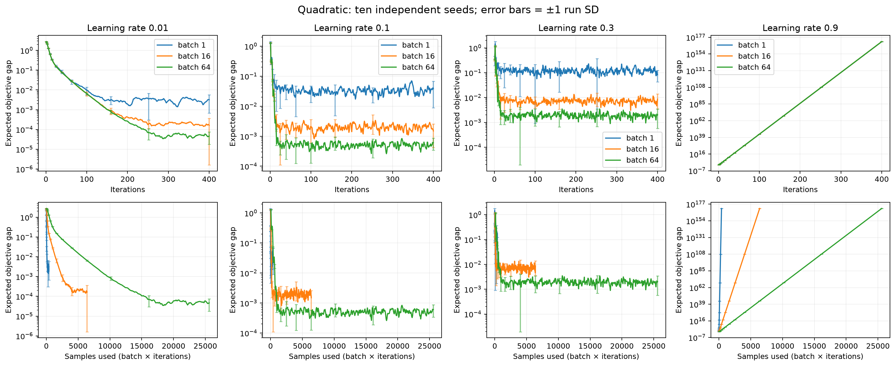
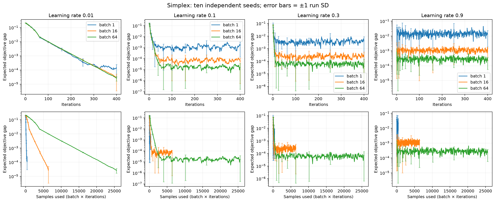
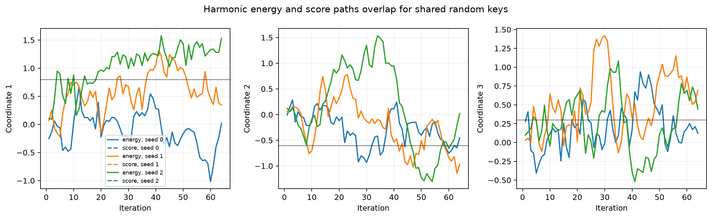
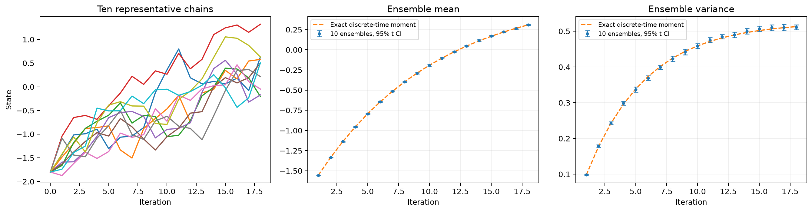

# Implementation writeup

## Exercise 2.1: Minibatch SGD

- **Minibatch evaluation:** vectorize the scalar loss over the fixed-capacity batch with `jax.vmap`. Index the sample PyTree by lane; the empty deterministic sample `()` also works.
- **Masking:** average only active lanes with the supplied `masked_mean`. Return all lane losses, including padded lanes, so the solver can compute its statistics.
- **Derivatives:** when individual gradients are requested, vectorize `jax.value_and_grad` and average the active gradients. Otherwise, differentiate the masked mean directly with `has_aux=True` to return the losses without storing individual gradients.
- **Momentum:** use the classical recurrence `v_new = momentum * v_old + gradient`. Return `v_new` as both the direction and the new `SGDState.velocity`. The outer solver applies the learning rate and projection.
- **Compatibility:** preserve PyTree structure, shapes, and floating dtypes. The implementation supports JIT, vectorization, and differentiation through the updates.

## Experiment settings

- Use the supplied quadratic and simplex objectives, their original parameters, and their exact reference solutions.
- Quadratic: target `(0.8, -0.6, 0.3, 1.1)`, diagonal curvature `(0.7, 1.3, 2.2, 4.0)`, forcing scale `0.35`, initial point zero, and momentum `0.6` as in the supplied example.
- Simplex: marginal benefits `(0.70, 0.45, 0.15, -0.30)`, forcing scale `0.15`, uniform initial allocation, no momentum, and projection onto the unit simplex. The exact solution is `(0.60, 0.35, 0.05, 0)`.
- Sweep learning rates `{0.01, 0.1, 0.3, 0.9}` and batch sizes `{1, 16, 64}` for **400 iterations each**. Use ten independent seeds, `0,...,9`, in float64 on CPU.
- Reuse a seed across configurations to share random numbers where possible; the ten trials within each configuration are independent.
- Plot the mean **true expected objective gap**, rather than noisy minibatch loss. Error bars are one sample standard deviation across the ten trials, drawn at selected iterations.
- The top row uses iteration count; the bottom row uses actual sample count `batch_size * iteration`. Padding is not counted as data.
- Lower error bars are truncated to remain positive on the logarithmic axis. The CSV retains the full standard deviations. Standard deviations for the deliberately divergent run are computed after scaling to avoid numerical overflow.

## Which hyperparameters perform best?

- **After 400 iterations, quadratic:** learning rate `0.01`, batch `64` gives the lowest observed mean gap, **4.6543e-5**, with run SD **2.8843e-5**. It uses **25,600 samples**.
- **After 400 iterations, simplex:** learning rate `0.1`, batch `64` gives the lowest observed mean gap, **1.6807e-5**, with run SD **2.0068e-5**. It also uses **25,600 samples**.
- **At an equal budget of 384 samples, quadratic:** learning rate `0.1`, batch `16` gives the lowest observed mean gap, **1.3021e-3**, after **24 iterations**.
- **At the same 384-sample budget, simplex:** learning rate `0.01`, batch `1` gives the lowest observed mean gap, **1.1187e-4**, after **384 iterations**.
- These are empirical rankings within the tested grid and budgets. The overlapping run variability does not establish a statistically unique best setting.
- The complete 24-configuration results are in [sgd_summary.csv](results/sgd_summary.csv). All ten gap curves for each configuration are saved in [sgd_gaps.npz](results/sgd_gaps.npz).

## Notable behavior

- **Noise floor:** stable constant learning rates approach a fluctuating neighborhood of the optimum. Larger batches reduce this fluctuation; smaller learning rates usually give lower late-stage error.
- **Sample cost:** a large batch can win at a fixed iteration count but use many more samples. With few samples available, fewer large-batch updates can leave substantial initial error.
- **Quadratic instability:** learning rate `0.9` diverges for every batch size. With momentum `m=0.6`, a scalar curvature mode is stable only when `0 < learning_rate * curvature < 2(1+m)`. Since the maximum curvature is `4`, the bound is `learning_rate < 0.8`; `0.9` violates it. Increasing the batch size cannot repair this deterministic instability.
- **Simplex feasibility:** every recorded allocation is nonnegative and sums to one within numerical precision. Projection keeps the iterates feasible even when the stochastic direction points outside the simplex.
- **Boundary solution:** the fourth allocation is zero at the optimum; random gradients can activate small positive allocations, which projection then corrects.

## Exercise 2.2: Langevin methods

- **Score convention:** for `score = gradient(log p_T) = -gradient(energy)/T`, return `-T * score` to the optimizer. This produces the same gradient as the energy formulation.
- **Temperature timing:** evaluate the score and noise temperature policies using the before-step context, which contains the previous minibatch statistics and old optimizer state.
- **Noise:** perturb the deterministic candidate by `sqrt(2 * learning_rate * temperature) * z`. Split the reserved PRNG key across PyTree leaves; sample every entry independently in the leaf's dtype.
- **Update order:** deterministic optimizer step, then Langevin perturbation, then projection. Objective sampling and Langevin noise use separate random streams supplied by the solver.
- **Diagnostics:** return evaluated temperature, noise scale, the global norm of the actual perturbation, and the temperature-validity flag.
- **Corner cases:** zero temperature gives the deterministic candidate exactly when allowed. Invalid constant temperatures raise at construction; invalid numeric dynamic temperatures produce NaNs and a false validity flag. Wrong shapes or non-real dtypes raise through the supplied helpers.
- **Differentiability:** retain continuous derivatives through scores, temperatures, and arguments. Use the supplied `safe_sqrt`, whose derivative at zero is defined to be zero.

## Harmonic energy/score comparison

- Repeat the supplied 64-step forced harmonic problem with ten seeds. Use the same key for the energy and score versions within each trial.
- Keep the supplied learning rate `0.04`, temperature schedule from `0.75` to `0.30`, and batch schedule from `4` to `19`.
- Across all ten seeds and all coordinates, the largest path difference is **4.4409e-16**. The descriptions agree to floating-point precision.
- The plot overlays both descriptions for three representative seeds. The dashed score curves lie on the energy curves. All ten paired trajectories and discrepancies are saved in [harmonic_paths.npz](results/harmonic_paths.npz).

## Gaussian ensemble

- Repeat the supplied experiment with **ten independent ensembles**, each containing **4,096 independent chains** and **18 updates**. Use initial state `-1.8`, mean `0.7`, curvature `1.4`, learning rate `0.07`, and temperature `0.7`.
- The left panel shows ten representative chains from the first ensemble. The middle panel plots the mean across ensemble means; its error bars are nominal 95% Student-t intervals, `2.262 * SD / sqrt(10)`. The right panel gives the analogous variance comparison.
- The final mean across ensembles is **0.308501**; the SD of the ten ensemble means is **0.010508**. The mean final within-ensemble variance is **0.511077**.
- This 18-step run has **not reached equilibrium**. The exact discrete recursion has contraction `a = 1 - 0.07 * 1.4 = 0.902`, mean `0.7 + a^k * (-1.8 - 0.7)`, and variance `2 * 0.07 * 0.7 * (1 - a^(2k)) / (1 - a^2)`.
- At step 18, these formulas predict mean **0.309467** and variance **0.512932**, consistent with the measurements.
- Even after full mixing, this unadjusted finite-step method has stationary variance **0.525762**, while the continuous Gibbs target has variance **0.5**. The discretization introduces bias; there is no Metropolis correction in this code.
- Saved ensemble means, variances, analytical curves, and representative chains are in [gaussian_ensembles.npz](results/gaussian_ensembles.npz).

## Validation and reproduction

- The **11 passing tests** cover masked batches in float32/float64, nested parameter trees, empty samples, higher derivatives, momentum, score conversion, invalid temperatures, independent noise, diagnostics, exact zero-temperature behavior, projection order, and continuation.
- The supplied stochastic and Langevin example programs also run successfully. Their complete reports are [stochastic_examples.json](results/stochastic_examples.json) and [langevin_examples.json](results/langevin_examples.json).
- The supplied Langevin examples also pass in float32; the shared-key harmonic discrepancy is `2.98e-8`, consistent with its lower precision. The report is [langevin_examples_float32.json](results/langevin_examples_float32.json).
- From the submission root, run `bash setup.sh`, then `.venv-implementation/bin/python -m pytest Implementation/tests -q`.
- Regenerate the assigned plots with `MPLCONFIGDIR=/tmp/hw4-matplotlib .venv-implementation/bin/python Implementation/run_experiments.py`.
- See the root [README](../README.md) for all commands, package versions, and output locations.

ChatGPT was used to understand the problems, assist with equations and implementation, check the results, and prepare this writeup.
