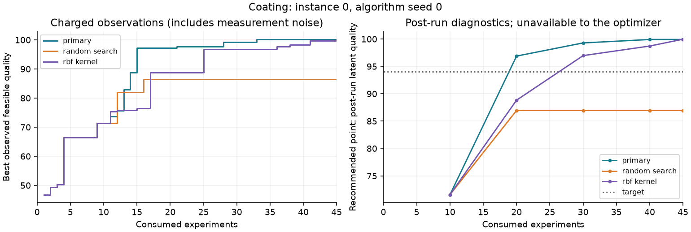
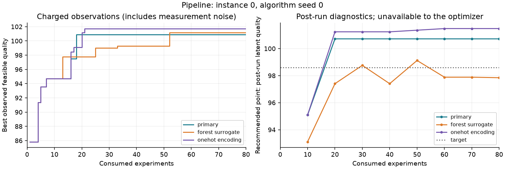
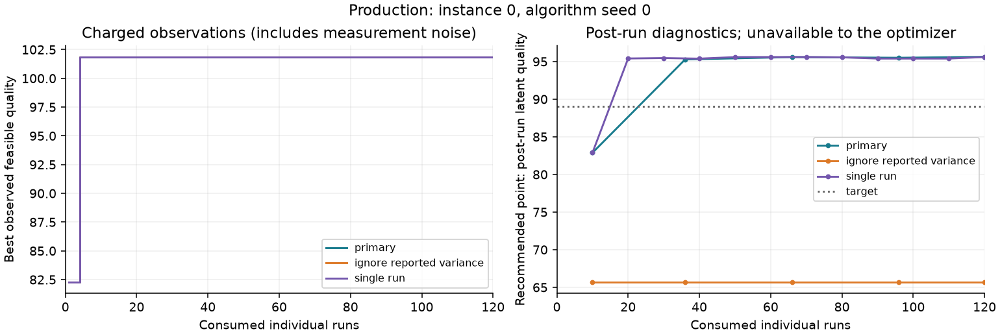
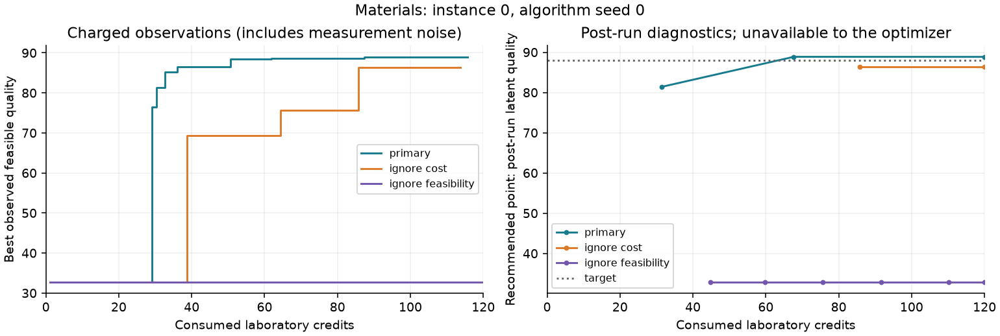
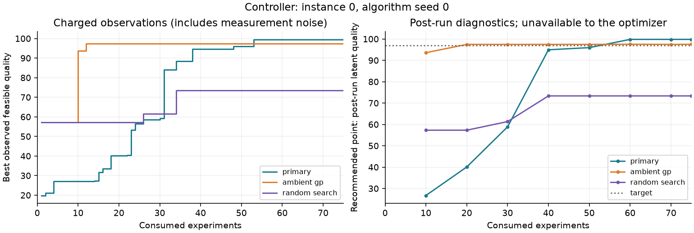
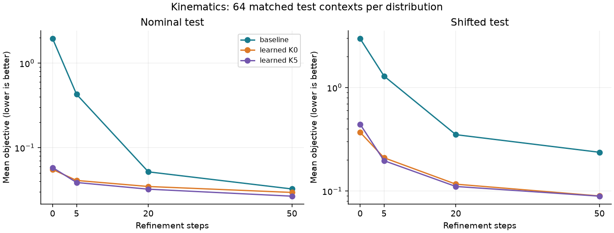
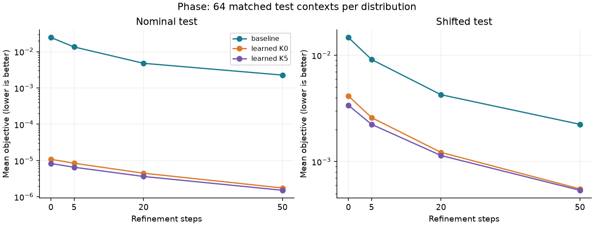

# Application solutions

- Covers Exercises 3.1 and 3.2; setup and reproduction commands are in the [submission README](../README.md).

## Exercise 3.1: Bayesian optimization

### Settings and rationale

- Ran each primary and both comparisons on **instance 0, seed 0**, with separate complete budgets; initialization, repeats, infeasible runs, and canceled reservations are charged.
- Primaries use a GP, Matérn-5/2 kernel, expected improvement, candidate acquisition search, MAP fitting (30 updates, refit every 6 observations), and posterior-based final recommendations.
- Shared settings: length scale 0.30, local candidate fraction 0.5, local scale 0.12, and improvement margin 0.01; remaining fields use supplied defaults.
- The surrogate/acquisition approach follows [Shahriari et al. (2016)](https://doi.org/10.1109/JPROC.2015.2494218); full configurations are in [results/bayesopt](results/bayesopt/).

| Problem | Primary settings | Reason |
|---|---|---|
| Coating | Noise SD 0.01; 512 candidates | Model smooth responses within 45 experiments. |
| Pipeline | Activity-aware encoding; 768 candidates; noise SD 0.04 | Handle conditional inputs and legal mixed-variable proposals. |
| Production | Known variances; 3 replicates; posterior incumbent; 512 candidates | Account for variable measurement noise and reduce sensitivity to lucky observations. |
| Materials | Feasibility weighting; EI divided by expected cost; noise SD 0.02; 512 candidates | Prioritize feasible recipes and useful experiments per credit. |
| Controller | One 5-dimensional embedding; 768 candidates; noise SD 0.04 | Concentrate the 75-experiment budget instead of searching all 24 directions equally. |

### Results

- Quality is the final recommendation's latent mean, scored **after** optimization; it is not the largest noisy observation.
- Budgets are experiments for coating/pipeline/controller, individual runs for production, and laboratory credits for materials; “runs” includes replicates.

| Problem | Variant | Quality | Target | Pass? | Observations | Runs | Consumed budget |
|---|---|---:|---:|---|---:|---:|---:|
| coating | `primary` | 99.915 | 94 | Yes | 45 | 45 | 45.000 |
| coating | `random_search` | 86.943 | 94 | No | 45 | 45 | 45.000 |
| coating | `rbf_kernel` | 99.965 | 94 | Yes | 45 | 45 | 45.000 |
| pipeline | `primary` | 100.720 | 98.6 | Yes | 80 | 80 | 80.000 |
| pipeline | `forest_surrogate` | 97.846 | 98.6 | No | 80 | 80 | 80.000 |
| pipeline | `onehot_encoding` | 101.480 | 98.6 | Yes | 80 | 80 | 80.000 |
| production | `primary` | 95.630 | 89 | Yes | 48 | 120 | 120.000 |
| production | `ignore_reported_variance` | 65.724 | 89 | No | 48 | 120 | 120.000 |
| production | `single_run` | 95.599 | 89 | Yes | 120 | 120 | 120.000 |
| materials | `primary` | 88.851 | 88 | Yes | 29 | 29 | 120.000 |
| materials | `ignore_cost` | 86.411 | 88 | No | 12 | 12 | 120.000 |
| materials | `ignore_feasibility` | 32.937 | 88 | No | 57 | 57 | 120.000 |
| controller | `primary` | 99.800 | 97 | Yes | 75 | 75 | 75.000 |
| controller | `ambient_gp` | 97.531 | 97 | Yes | 75 | 75 | 75.000 |
| controller | `random_search` | 73.347 | 97 | No | 75 | 75 | 75.000 |

### Coating

- `random_search` tests surrogate-guided selection against random proposals; `rbf_kernel` changes only the smoothness assumption.
- Both GPs pass, while random search fails; RBF is slightly better than the primary in this trial.

### Pipeline

- `onehot_encoding` tests representation of conditional inputs; `forest_surrogate` tests a bootstrap forest with its required fixed-hyperparameter setting.
- One-hot performs best here; the primary also passes, while the forest misses the target.

### Production

- `single_run` tests more distinct settings versus replication; `ignore_reported_variance` tests the value of calibrated noise information.
- Primary and single-run quality are almost equal; ignoring reported variances fails badly in this trial.
- Replicated variants use 48 observations for 120 runs: 12 initial single runs plus 36 three-run averages; the single-run comparison tests 120 settings.

### Materials

- `ignore_cost` tests credit efficiency; `ignore_feasibility` removes constraint weighting from proposals while retaining the package's feasible final-recommendation rule.
- Only the primary passes; primary/no-cost/no-feasibility variants complete **29/12/57** runs, including **7/3/53** infeasible observations.
- Primary consumes 115.640 experiment credits plus a 4.360-credit canceled reservation; no-cost consumes 113.671 plus 6.329 canceled credits.
- No-feasibility uses 119.9996 credits, but almost all its observations are infeasible, leaving a poor feasible recommendation.

### Controller

- `ambient_gp` tests removal of the embedding; `random_search` tests random ambient-space search, changing both search strategy and embedding.
- The embedded primary performs best; ambient GP also passes, while random search fails.
- Embeddings restrict the accessible search space, so this result is not a guarantee for arbitrary 24-dimensional objectives.

- In every figure, the left panel is best observed feasible quality (including noise); the right is post-run latent recommendation quality, never supplied to the policy.
- These are single-instance, single-seed comparisons; all failed variants are retained in the [numeric summary](results/bayesopt_summary.csv).

## Exercise 3.2: learning to warm-start

### Objectives

- Implemented scalar, differentiable JAX objectives and retained the supplied projections, solver, and model:

  $$f_{\rm IK}(q)=\tfrac12\|F(q)-t\|_2^2+\tfrac\lambda2\|q-q_{\rm pref}\|_2^2,$$

  $$f_{\rm phase}(y)=\frac1{4m}\sum_i\big((a_i^T y)^2-b_i\big)^2.$$

### Safe inverse-kinematics step

- Let $S=\sum_i l_i$, $s_j=\sum_{i\ge j}l_i$, and $e=F(q)-t$; throughout the box, $\|e\|\le S+\|t\|$ and $\|J^TJ\|\le\sum_j s_j^2$.
- Write $F(q)=\sum_i l_i u_i$, where $u_i=(\cos\sum_{j\le i}q_j,\sin\sum_{j\le i}q_j)$; let $v_i$ have ones in its first $i$ entries.
- The residual Hessian term is $-\sum_i l_i(e^Tu_i)v_iv_i^T$; since $\|v_iv_i^T\|=i$, its norm is bounded by $(S+\|t\|)\sum_i i l_i$.
- Therefore a whole-box Hessian bound, including regularization, is:

  $$L_{\rm IK}=\sum_j s_j^2+(S+\|t\|_2)\sum_i i l_i+\lambda.$$

### Safe phase-retrieval step

- The Hessian is $\nabla^2f(y)=A^T\operatorname{diag}(3(Ay)^2-b)A/m$.
- On $[-r,r]^n$, $(a_i^Ty)^2\le M_i=r^2\|a_i\|_1^2$; hence $|3(a_i^Ty)^2-b_i|\le d_i=\max(|b_i|,|3M_i-b_i|)$.
- For $B=A^T\operatorname{diag}(d)A/m$, every vector satisfies $|v^T\nabla^2f(y)v|\le v^TBv\le\lambda_{\max}(B)\|v\|^2$; use $L_{\rm phase}=\lambda_{\max}(B)$.
- Both functions return **$1/\max(L,\epsilon)$**, with dtype-specific machine epsilon; these bounds hold throughout the feasible boxes and give projected-gradient descent in exact arithmetic, without guaranteeing a global optimum.

### Training and tuning

- Following the warm-start setup of [Sambharya et al. (2024)](https://www.jmlr.org/papers/v25/23-1174.html), compared the supplied nonlearned start with separate networks trained at **$K_{\rm train}=0$ and 5**, using the objective after unrolled solver steps.
- Nonlearned starts: projected preferred posture for kinematics; spectral initialization for phase retrieval.
- Used CPU float64, seed 7, 1,024 training contexts, 128 validation contexts, batch size 64, gradient clipping at 10, and validation checks every 50 updates.
- Selected settings by the mean of the two networks' best validation objectives; final-test data were excluded from selection.

| Candidate | Width | Learning rate | Updates | IK validation score | Phase validation score |
|---|---:|---:|---:|---:|---:|
| Baseline | 64 | 0.002 | 300 | 0.0668144 | 4.32511e-5 |
| Wider, slower rate | 128 | 0.001 | 1,000 | 0.0580028 | 8.44675e-6 |
| Selected | 128 | 0.003 | 1,000 | 0.0526379 | 5.40071e-6 |

- Retained all tuning alternatives in the [tuning summary](results/warmstart_tuning_summary.csv); changing several settings together does not isolate their individual effects.

### Test results

- Evaluated each method at **0, 5, 20, and 50** refinement steps on the same **64 nominal** and **64 shifted** contexts, with evaluation seeds 107 and 108.
- Tables show mean objective; lower is better, and values are not certified global optimality gaps.

**Kinematics**

| Distribution | Starting method | 0 steps | 5 steps | 20 steps | 50 steps |
|---|---|---:|---:|---:|---:|
| Nominal | Nonlearned | 1.95934 | 0.428519 | 0.0515209 | 0.0322757 |
| Nominal | Learned K=0 | 0.0550002 | 0.040738 | 0.0345178 | 0.0293596 |
| Nominal | Learned K=5 | 0.0579054 | 0.0385142 | 0.0320818 | 0.026508 |
| Shifted | Nonlearned | 2.97877 | 1.29358 | 0.350411 | 0.236652 |
| Shifted | Learned K=0 | 0.369494 | 0.209365 | 0.116266 | 0.0893845 |
| Shifted | Learned K=5 | 0.442225 | 0.196152 | 0.110425 | 0.0889755 |

**Phase**

| Distribution | Starting method | 0 steps | 5 steps | 20 steps | 50 steps |
|---|---|---:|---:|---:|---:|
| Nominal | Nonlearned | 0.0245717 | 0.0134919 | 0.00477784 | 0.00226132 |
| Nominal | Learned K=0 | 1.0847e-05 | 8.43213e-06 | 4.48952e-06 | 1.7557e-06 |
| Nominal | Learned K=5 | 8.28461e-06 | 6.54876e-06 | 3.64607e-06 | 1.5187e-06 |
| Shifted | Nonlearned | 0.0147018 | 0.00913029 | 0.00425611 | 0.00224301 |
| Shifted | Learned K=0 | 0.00414499 | 0.00259616 | 0.0012213 | 0.000554018 |
| Shifted | Learned K=5 | 0.00338598 | 0.00224107 | 0.00114133 | 0.000537774 |

- **Kinematics:** learned starts improve on the baseline; K=0 has the better nominal raw prediction, while K=5 performs better after refinement.
- **Phase:** K=5 has the lower mean objective at every reported horizon; both networks outperform the spectral start.
- **Shift:** both problems deteriorate under shift, but learned starts remain better than the baseline after 50 steps.
- **Tuning:** nominal 50-step K=5 objectives improve from 0.0306820 to 0.0265080 for kinematics and from 1.39828e-5 to 1.51870e-6 for phase.
- All reported outputs satisfy their boxes; results use one training seed, numerical best-found references, and equal step counts, so they do not establish global optimality or a wall-clock speedup.

### Verification

- **112 BO tests and 49 warm-start tests pass**, including independent objective/gradient checks; both problem checkers pass, and all TODO markers remain.
- Hessian sampling checks support the implementation; the whole-box guarantees come from the derivations above.

**AI usage:** OpenAI Codex (GPT-6) assisted with mathematical derivations, configuration choices, coding, experiments, figures, and writeup editing.
