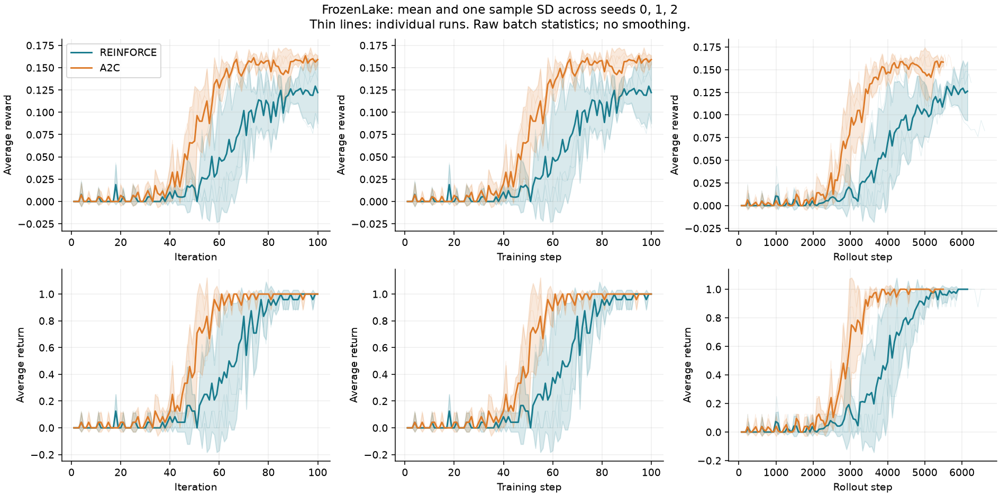
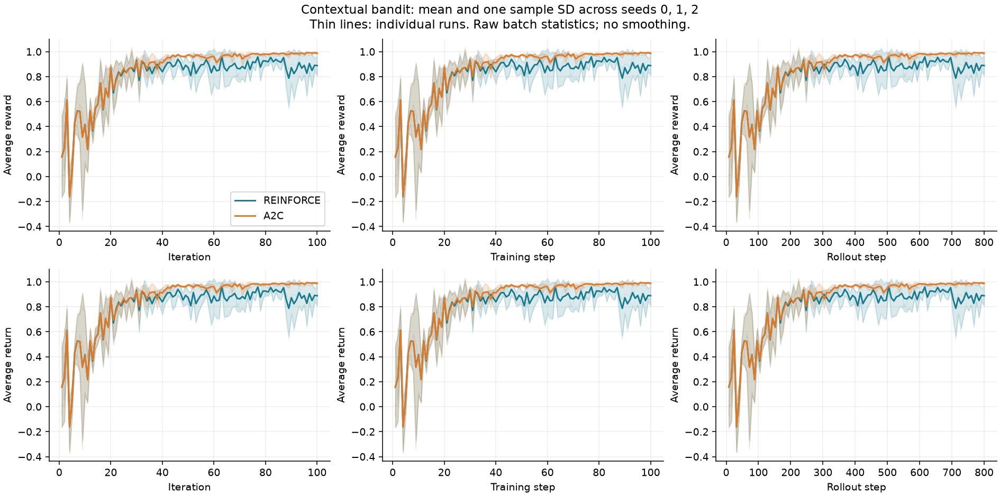
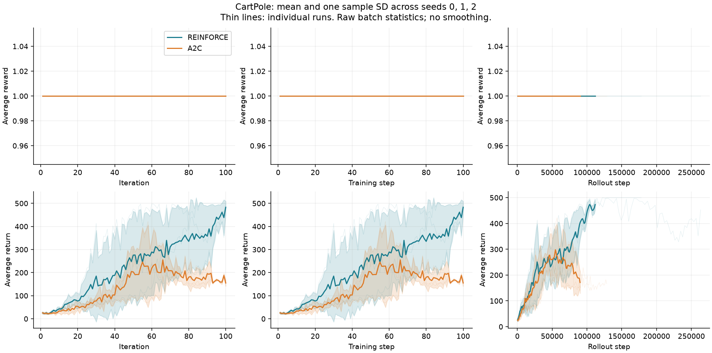
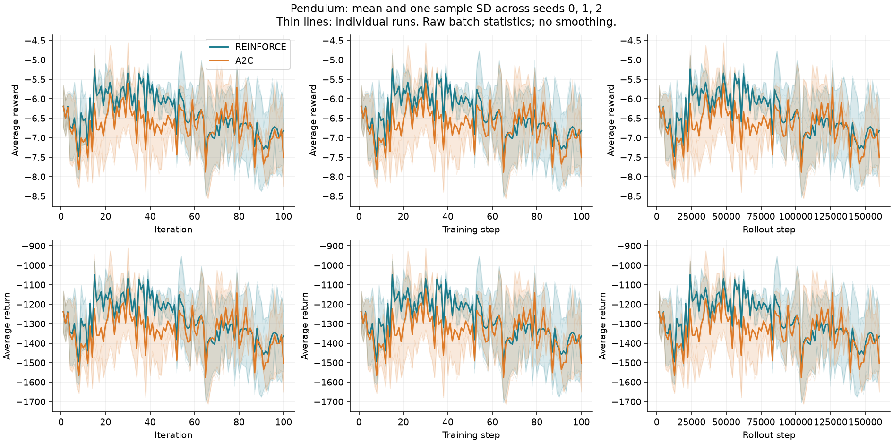

# Implementation solutions

- Covers Exercise 2.1; optional diffusion Exercise 2.2 was not attempted.
- Setup and reproduction commands are in the [submission README](../README.md).

## Implementation

- **`n_step_returns`:** forms $G_t=\sum_{j=0}^{k-1}\gamma^j r_{t+j}+\gamma^kV_{\rm tail}$ and returns targets, masks, and reward counts with fixed `[time, batch]` shapes.
- Stops at termination, truncation, padding, the requested horizon, or the stored-axis end; termination uses zero tail, while other boundaries use the actual final next-state value and never cross resets.
- Bootstrap mode keeps valid starts; drop mode requires a complete finite horizon or true termination; invalid starts have zero target/count, and return construction remains differentiable.
- Uses a backward JAX scan for full returns and repeated fixed-shape extension for finite horizons.
- **`weighted_log_probability_gradient`:** uses nested `vmap` and `grad` to differentiate $\sum_{t,b}c_{t,b}\log\pi_\theta(a_{t,b}\mid s_{t,b})$; recorded data and coefficients are fixed, and no additional sign or normalization is applied.
- **`reinforce_actor_loss`:** reduces $-\log\pi_\theta(a\mid s)A-\eta H$ with the supplied masks, optional $\gamma^{\text{episode step}}$ weights, and episode/transition denominator.
- **`critic_loss`:** detaches prepared targets, evaluates recorded environment actions, masks residuals before squaring, and returns half the masked mean squared error; entirely masked losses are zero.
- The policy-gradient formulation follows [Sutton et al. (1999)](https://proceedings.neurips.cc/paper_files/paper/1999/hash/464d828b85b0bed98e80ade0a5c43b0f-Abstract.html).

## Experiment settings

- For each algorithm/environment, used **100 iterations, 8 environments, complete-episode collection, a 500-step cap, and seeds 0, 1, 2**; the cap covers the supplied episode limits.
- Used CPU float32, the supplied MLP, discount 0.99, Adam actor rate **0.003**, actor-gradient clipping at 1, and entropy coefficient **0.01**.
- **REINFORCE:** complete Monte Carlo returns, zero tail, and no critic; **A2C:** eight-step bootstrapped returns, state-value advantages, and Adam critic rate 0.001.
- Both use episode reduction and outer within-episode discount; equal iterations can consume different numbers of transitions as episode lengths change.

## Results and plots

- Each figure plots average immediate reward and undiscounted completed-episode return against iteration, successful training updates, and cumulative valid transitions.
- Curves use pre-update collection statistics; bold lines are three-seed means, shading is one sample SD, and faint lines are individual runs; there is no temporal smoothing.
- Rollout-axis means interpolate only within the seeds' shared observed range; iteration and training-step axes coincide because every update has valid data.
- The table averages the final 10 batch returns within each seed, then reports the mean and sample SD across seeds; these are training statistics, not separate checkpoint evaluations.

| Environment | Algorithm | Final-10 return, mean ± seed SD | Mean immediate reward | Total transitions per seed |
|---|---|---:|---:|---:|
| FrozenLake | REINFORCE | 0.9875 ± 0.0125 | 0.1233 | 6,148–6,612 |
| FrozenLake | A2C | 0.9958 ± 0.0072 | 0.1583 | 5,495–5,789 |
| Contextual bandit | REINFORCE | 0.8714 ± 0.1065 | 0.8714 | 800 |
| Contextual bandit | A2C | 0.9875 ± 0.0043 | 0.9875 | 800 |
| CartPole | REINFORCE | 425.9583 ± 64.4698 | 1.0000 | 111,709–263,301 |
| CartPole | A2C | 170.2375 ± 6.6818 | 1.0000 | 90,087–128,428 |
| Pendulum | REINFORCE | -1393.9790 ± 177.9082 | -6.9699 | 160000 |
| Pendulum | A2C | -1436.9002 ± 133.8307 | -7.1845 | 160000 |

### FrozenLake

- Both methods learn high-success policies on the deterministic map; A2C uses fewer transitions, while sparse rewards make episodic return easier to interpret than per-step reward.

### Contextual bandit

- A2C achieves higher, more consistent returns; a critic baseline can reduce gradient variance, though this experiment does not isolate that cause; reward and return coincide because episodes last one step.

### CartPole

- REINFORCE has the better final return; A2C improves early but later declines, while immediate reward stays at 1 for both; compare the rollout axis because longer episodes give REINFORCE more experience.

### Pendulum

- Neither method reliably solves swing-up/balancing within this budget; seed variation gives no clear winner, and both consume 160,000 transitions per seed; longer training and validation-based tuning would be needed to assess improvement.

## Final-policy videos

- Recorded two deterministic episodes from each **final seed-0 checkpoint**, using evaluation seeds **1000 and 1001**; these demonstrations are separate from the stochastic training curves.

| Environment | Algorithm | Video folder | Recorded episode returns |
|---|---|---|---|
| CartPole | REINFORCE | [MP4 episodes](results/policy-videos/cd-reinforce/) | 500, 500 |
| CartPole | A2C | [MP4 episodes](results/policy-videos/cd-a2c/) | 147, 130 |
| Pendulum | REINFORCE | [MP4 episodes](results/policy-videos/cc-reinforce/) | -1334.195, -1418.159 |
| Pendulum | A2C | [MP4 episodes](results/policy-videos/cc-a2c/) | -1263.446, -1305.921 |

- Pendulum videos show the limited learned behavior; two evaluation episodes are insufficient for a precise performance estimate.

## Verification and saved files

- All **90 supplied implementation tests pass**, including Optax integration; all four TODO comments are preserved.
- [Raw histories and checkpoints](results/gym-comparison/), [numeric summary](results/training_summary.csv), and [reproduction commands](../README.md) are included.

**AI usage:** OpenAI Codex (GPT-6) assisted with implementation, mathematical checks, experiment execution, figures, videos, and writeup editing.
